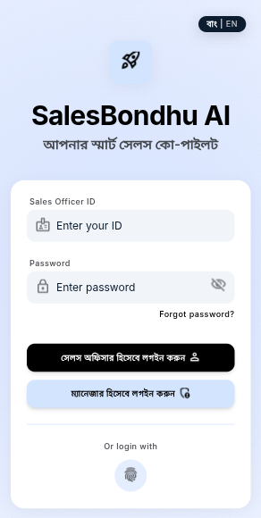
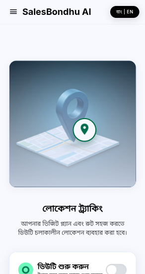
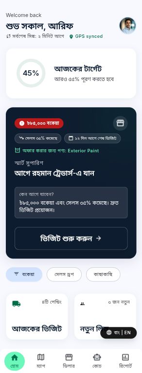
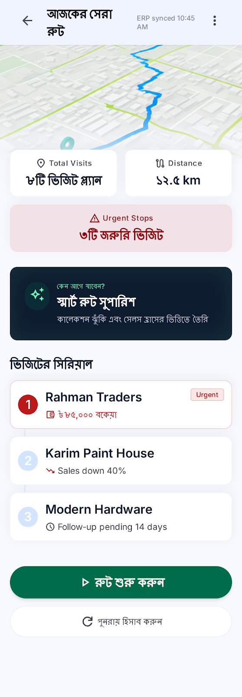

# SalesBondhu AI — Manager Web Dashboard & Prototype

<!-- SALESBONDHU_MOBILE_PREVIEW_START -->

## 📱 SalesBondhu Mobile Product Preview

> These Stitch design screens present the current mobile product direction.
> This repository contains an earlier web prototype; the production Flutter
> implementation is maintained privately.

<p align="center">
  
  
  
  
</p>

<!-- SALESBONDHU_MOBILE_PREVIEW_END -->

## About SalesBondhu AI

SalesBondhu AI is a mobile-first field-sales co-pilot and management platform designed to help sales officers organize daily market visits, prioritize dealer interactions, and streamline duty workflows.

This repository (`SalesBondhu-AI`) contains the **earlier web prototype and manager dashboard**, which provides desktop web panels for dashboard reporting, risk analysis, and supervisor monitoring. The mobile field application used by sales officers on the ground is maintained separately in a private Flutter repository.

---

## The Problem
Field sales officers and their managers often struggle with fragmented information. Essential data—such as dealer stock levels, transaction histories, outstanding credit, and specific manager instructions—is frequently scattered across different systems. This leads to inefficient route planning, missed follow-ups, and lagging market visibility for managers.

---

## The Solution
SalesBondhu AI converts scattered field-sales data into a guided daily workflow. The platform provides:
1. **Priority & Context**: Identifying which dealer is most critical to visit first and why (e.g., credit overdue, declining sales volume).
2. **Actionable Insights**: Recommending next-best-actions like payment collection or specific product offerings.
3. **Logistics & Tracking**: Optimizing visit routes and providing transparent duty tracking and visit outcomes for managers.

---

## Architecture & Pipeline
The system is designed to scale across a decoupled architecture:
* **Manager/Admin Web Dashboard (React/Vite)**: This repository. A desktop web panel for supervisors to monitor field activities, review risk analysis, and manage teams.
* **Sales Officer Mobile App (Flutter/Dart)**: The Android field tool optimized for mobile responsiveness and offline-first sync (maintained privately).
* **Backend + Intelligence Layer**: Shared API endpoints managing security, geofenced location checks, transaction syncing, and an AI intelligence engine for collection risk detection and route optimization.

---

## Technical Stack
* **Framework**: React + TypeScript
* **Build Tool**: Vite
* **Linting & Code Quality**: ESLint (Type-aware rules enabled)
* **Styling**: Modern CSS/Tailwind (planned/implemented based on components)

### Local Setup
1. Clone the repository and navigate to the project directory.
2. Install dependencies:
   ```bash
   npm install
   ```
3. Run the development server:
   ```bash
   npm run dev
   ```
