# SalesBondhu AI

**A Bangla-first AI co-pilot for field sales teams: officers in the market, managers in the office.**

[](https://github.com/muhammadTasin/SalesBondhu-AI/actions/workflows/ci.yml)


> **Public showcase edition.** The production app is private under client confidentiality; this
> repository is the UI prototype with mock data and service stubs. It shows what the product does,
> how the AI features work and how the system is built, without any client code or client data.
> Every name, number and product in this repo is invented.

SalesBondhu helps a paint company's field officers plan the day, visit dealers, collect dues, prove
each visit and get coaching in Bangla, and gives their managers a live view of the whole team. The
production system is in a live pilot with **Aqua Paints**' field sales team in Bangladesh. The
manager web console has its own showcase repo:
**[SalesBondhu-AI-Web](https://github.com/muhammadTasin/SalesBondhu-AI-Web)**.

<p align="center">
  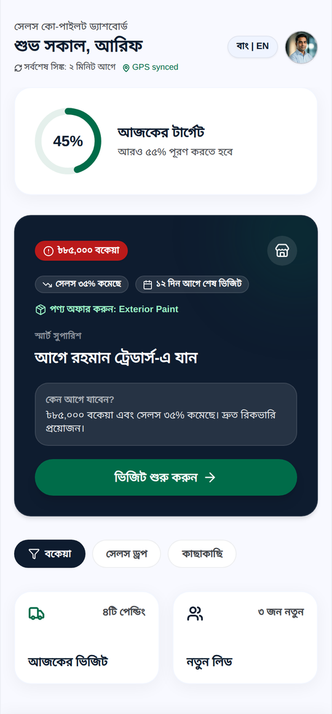
  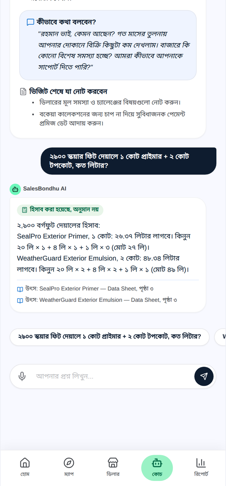
  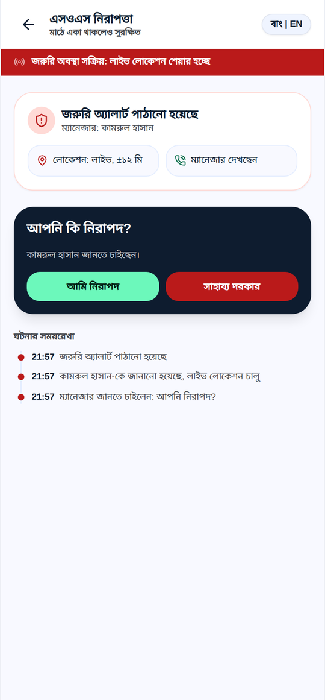
  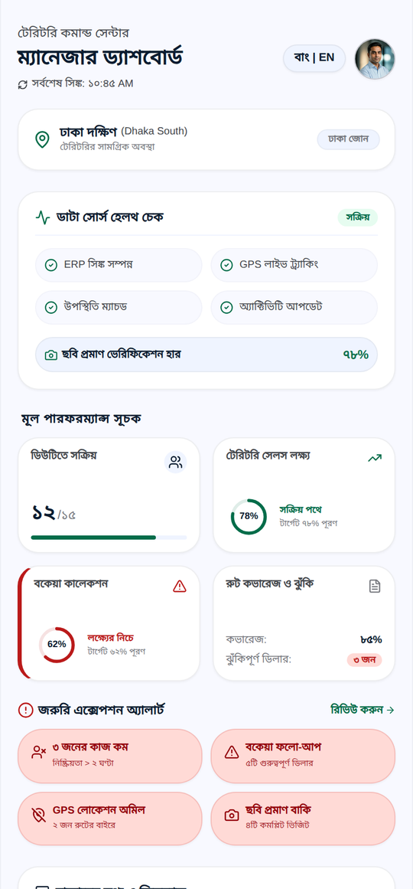
</p>

## What it does

| # | Feature | What the officer or manager gets | In this repo |
|---|---|---|---|
| 1 | White-label branding | The app ships in the client's own brand | [`src/config/brand.ts`](src/config/brand.ts) |
| 2 | Sign in, Bangla / English | Sales ID sign-in; every screen switches language in one tap | [`LoginRoleSelection`](src/screens/LoginRoleSelection.tsx) |
| 3 | Guided setup | Location is recorded only while on duty, with consent | [`DutyTrackingConsent`](src/screens/DutyTrackingConsent.tsx) |
| 4 | Officer home | Today's target, who to visit first and why, unpaid dues | [`TodayDashboard`](src/screens/TodayDashboard.tsx) |
| 5 | Visit plan | Dealers ranked by priority, one route for the day | [`TodayVisitPlan`](src/screens/TodayVisitPlan.tsx), [`OptimizedRoute`](src/screens/OptimizedRoute.tsx) |
| 6 | **AI sales coach** | Answers in Bangla from company documents and shows the page; works out exact paint quantities | [`src/ai/`](src/ai), [`SalesCoach`](src/screens/SalesCoach.tsx) |
| 7 | Live visit | Distance to the shop, dues warning, call / WhatsApp / SOS | [`ActiveVisit`](src/screens/ActiveVisit.tsx) |
| 8 | Visit proof | Photo locked with GPS, time and a SHA-256 fingerprint; order, collection, competitor notes | [`photoProof.ts`](src/lib/photoProof.ts), [`PhotoProofUploader`](src/components/PhotoProofUploader.tsx) |
| 9 | **SOS safety** | Hold to alert the manager with live location; only the manager can close it | [`SosSafety`](src/screens/SosSafety.tsx) |
| 10 | Command center | Who is on duty, targets, collections, items that need attention | [`manager/ManagerDashboard`](src/screens/manager/ManagerDashboard.tsx) |
| 11 | Territory & risk | Live / stale / offline officers, GPS mismatches, dues risk | [`ManagerTerritoryMap`](src/screens/manager/ManagerTerritoryMap.tsx), [`ManagerRiskCenter`](src/screens/manager/ManagerRiskCenter.tsx) |
| 12 | End-of-day review | Managers check each visit's evidence and export the team report | [`ManagerEndDayReview`](src/screens/manager/ManagerEndDayReview.tsx) |

## The AI sales coach

Officers ask the way they talk: in Bangla, in English, or in Banglish typed on a phone keyboard
("2900 sqft deyal e 1 kot primer koto litar lagbe?"). The coach never guesses an answer it can't back up.

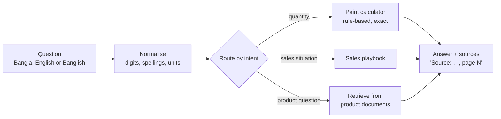

- **Numbers come from a calculator, not a language model.** Litres and pack sizes are computed
  from the product's documented coverage ([`paintCalculator.ts`](src/ai/paintCalculator.ts)), and the
  answer cites the data-sheet page the figure came from.
- **Every grounded answer shows its sources.** When nothing relevant is found, the coach says so
  instead of making something up ([`coachEngine.ts`](src/ai/coachEngine.ts)).
- **Banglish is a first-class input** ([`banglish.ts`](src/ai/banglish.ts)): Bangla digits, unit
  spellings (স্কয়ার ফিট / sq ft / sqft) and common Banglish words map to one vocabulary.

In production, retrieval runs over the client's own documents with multilingual embeddings and a
vector store, a local open-weight language model writes the Bangla answer, and the answer is checked
against the retrieved passages before it is shown. This showcase replaces the model with templates
and a small invented knowledge base, so it runs fully offline with no keys.

<p align="center">
  
  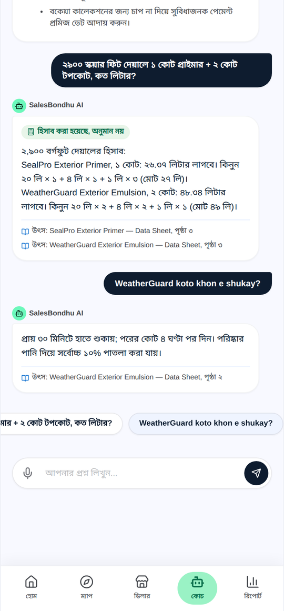
</p>

## Screens

**Field officer**

<p align="center">
  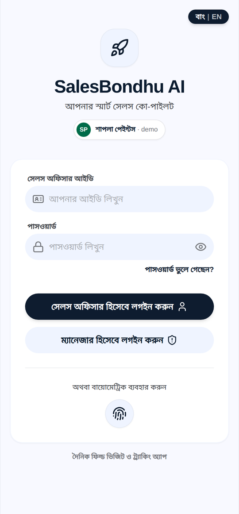
  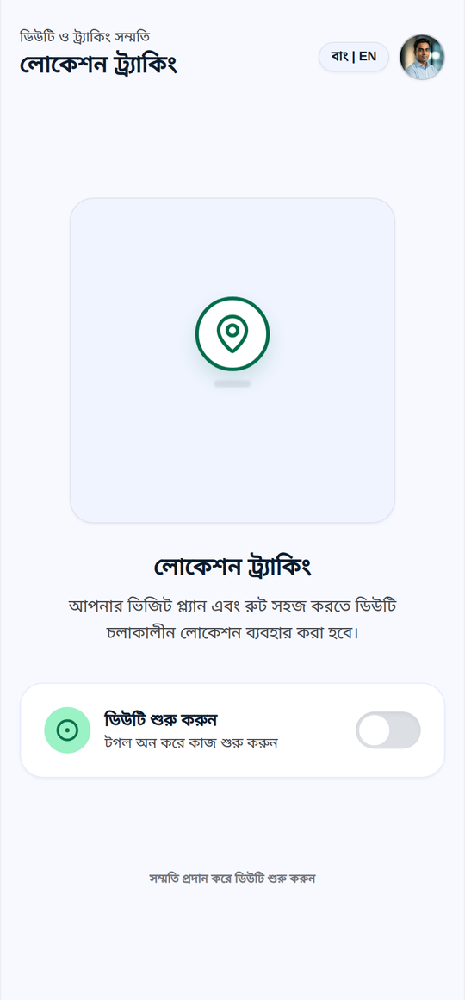
  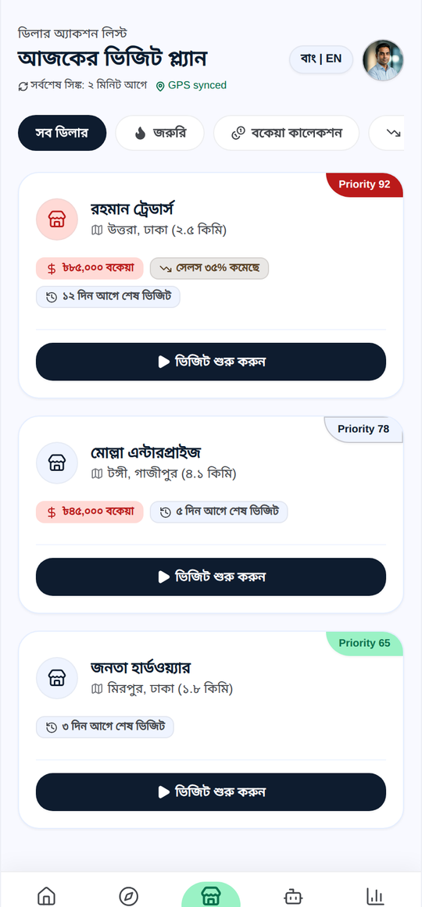
  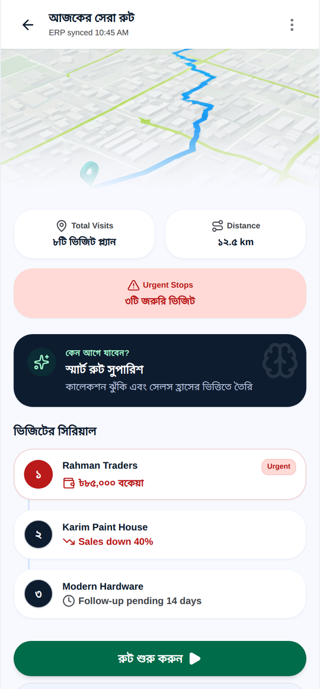
  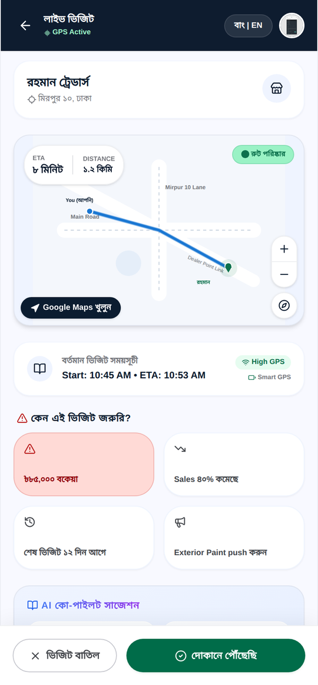
</p>

**Safety**

<p align="center">
  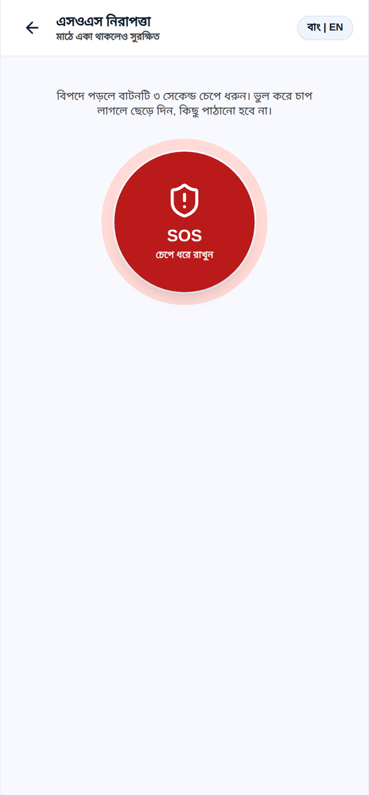
  
</p>

**Manager**

<p align="center">
  
  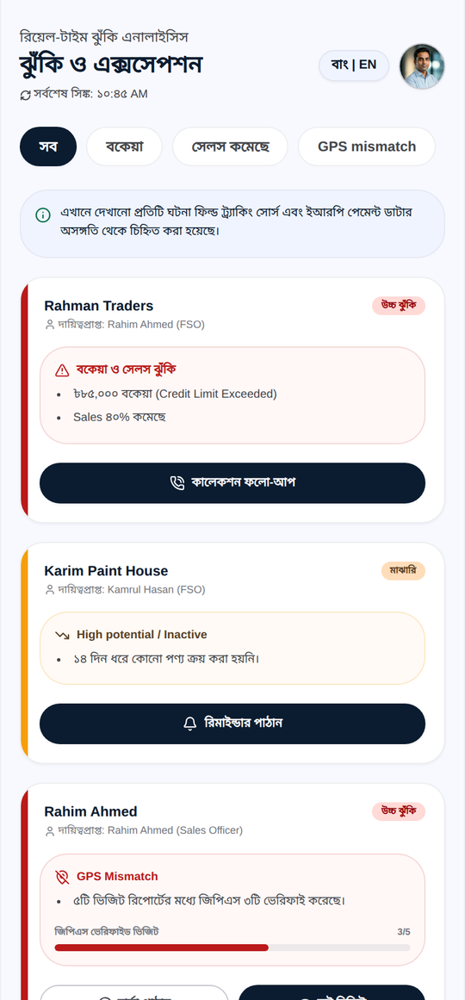
  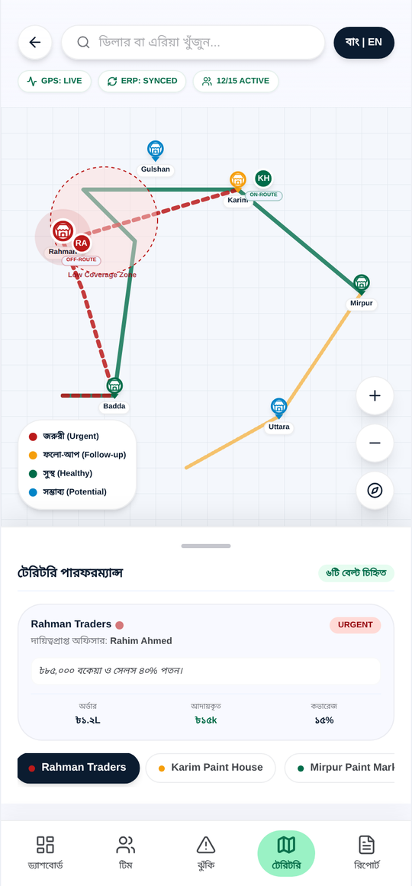
  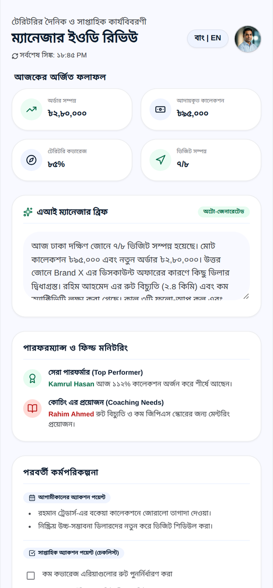
</p>

## How the full system is built

| Part | Production (private) | This showcase |
|---|---|---|
| Officer & manager app | Flutter (Android), offline queues, background duty tracking | React 19 + Vite + Tailwind prototype in a phone frame |
| Manager web console | React + TypeScript | [SalesBondhu-AI-Web](https://github.com/muhammadTasin/SalesBondhu-AI-Web) |
| Backend | FastAPI + PostgreSQL, REST API | none: mock data in the browser |
| AI coach | Retrieval over client documents, multilingual embeddings, vector store, local open-weight LLM, grounding checks | [`src/ai/`](src/ai): same flow, invented documents, templated answers |

More detail: [`docs/ARCHITECTURE.md`](docs/ARCHITECTURE.md).

## Development activity

The production code lives in private repos, so this one can't show its history. Here is the real
activity from the private app repo:

<p align="center">
  <picture>
    <source media="(prefers-color-scheme: dark)" srcset="docs/img/activity-dark.svg" />
    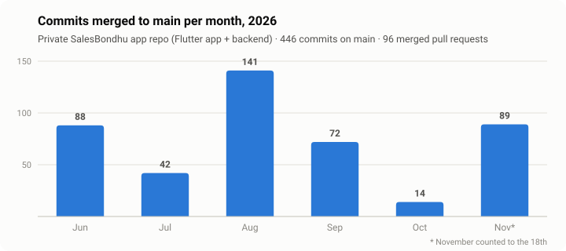
  </picture>
</p>

- **App + backend repo:** 446 commits on `main` (579 across all branches) since 18 June 2026,
  96 merged pull requests, versioned releases running in a live pilot.
- **Manager web console repo:** 31 commits on `main` and 7 merged pull requests since 31 October 2026.
- **This prototype:** the first UI prototype (June–July 2026), extended in November 2026 with the
  coach engine, SOS flow, photo proof and white-label config.

## Run it

```bash
npm ci
npm run dev        # open the printed URL, pick "sales officer" or "manager" on the login screen
npm test           # unit tests for the coach engine, calculator and photo proof
npm run build
```

No keys or backend are needed: every screen runs on mock data.

## Project structure

```
src/
  ai/            coach engine: Banglish normaliser, paint calculator, knowledge base, router (+ tests)
  config/        white-label brand config
  screens/       officer screens; manager/ holds the manager screens
  components/    shared UI (phone frame, cards, photo proof uploader, …)
  lib/           mock session, photo proof (SHA-256 + GPS + time), demo actions
  services/      offline visit queue, upload stubs
docs/            architecture, screen inventory, screenshots
```

## License

Copyright © 2026 muhammadTasin. All rights reserved. The source is shared for review and
evaluation only; see [LICENSE](LICENSE).
