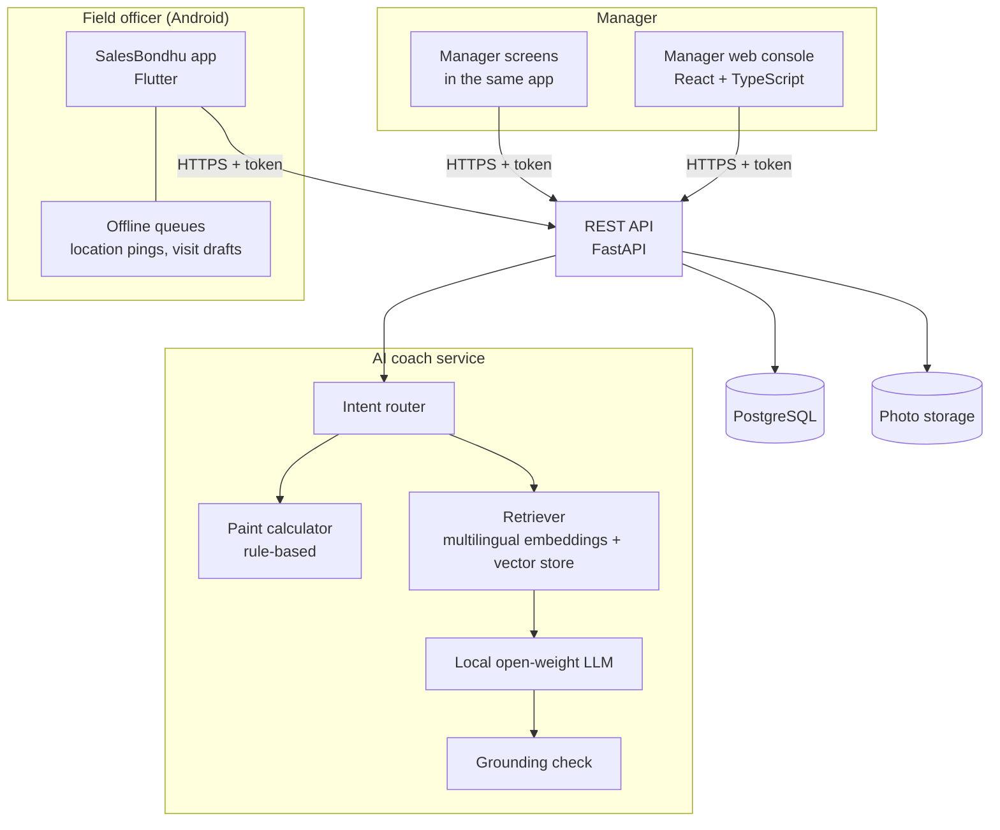

# Architecture

This page describes how SalesBondhu is built at a high level. The production code is private; this
repository is a showcase prototype that mirrors the product's screens and AI flow with mock data.

## System overview

## Design principles

- **Bangla first.** Every screen is written in Bangla with an English toggle, and the coach accepts
  Bangla, English and Banglish.
- **Works with poor signal.** The field app queues location pings and visit drafts on the device
  and sends them when the network returns.
- **Location only on duty.** Tracking starts and stops with the officer's duty toggle, after
  explicit consent.
- **Evidence a manager can trust.** Each visit photo is locked to where and when it was taken and
  fingerprinted, so a reviewer can see if anything was changed.
- **AI that shows its work.** Quantities come from a calculator, product answers cite the document
  page, and an answer that can't be grounded is not shown as fact.
- **Safety is never silently closed.** An SOS stays open, with location sharing on, until a
  manager closes it.

## What this showcase contains

| Layer | Showcase implementation |
|---|---|
| UI | React 19 + Vite + Tailwind; officer and manager screens inside a phone frame |
| Data | Hard-coded mock data; an offline visit queue in `localStorage` |
| AI coach | `src/ai/`: normaliser, router, calculator and keyword retrieval over invented documents, with unit tests |
| Visit proof | `src/lib/photoProof.ts`: SHA-256 via Web Crypto, browser geolocation with a demo fallback |
| Backend | None. `src/lib/supabase.ts` is an optional stub from the first prototype and is off by default |
